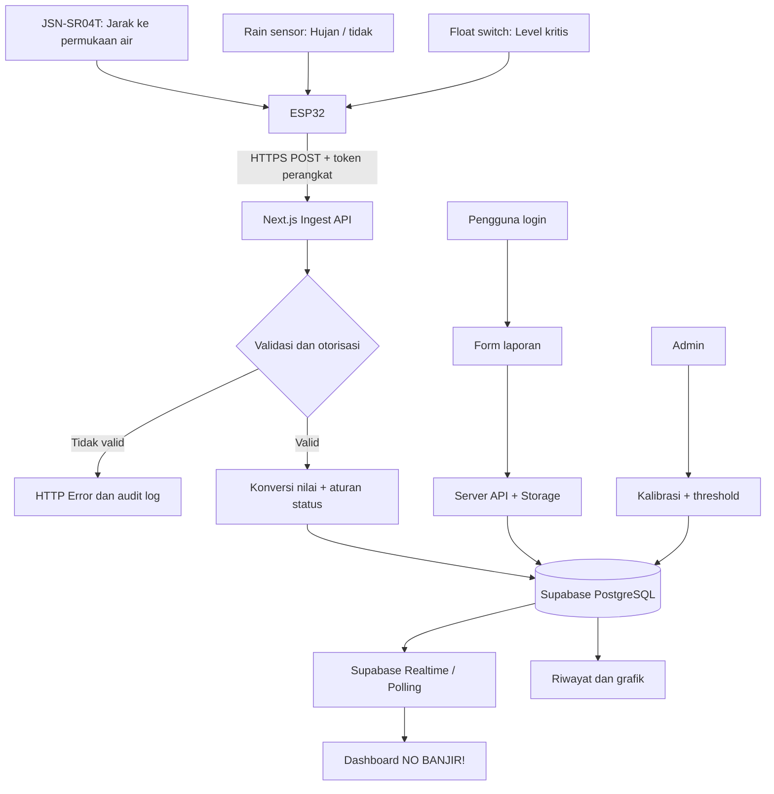

# NO BANJIR! — Spesifikasi Pengembangan Aplikasi Web Peringatan Dini Banjir Berbasis IoT

> **Jenis dokumen:** Product Requirements Document (PRD) + panduan implementasi untuk AI coding assistant / developer.  
> **Nama proyek:** NO BANJIR!  
> **Penggagas:** Kelompok Power Rangers — SMK Negeri 26 Jakarta  
> **Program:** Jakarta SDGs Futuremakers 2026/2027  
> **Target awal:** Lingkungan SMK Negeri 26 Jakarta; arsitektur disiapkan agar kelak dapat diperluas ke tingkat RT/RW.  
> **Status dokumen:** Rancangan aplikasi yang akan dikembangkan, **bukan** klaim bahwa sistem sudah terpasang atau beroperasi.

---

## 1. Instruksi utama untuk AI coding assistant

**Bangun aplikasi web fungsional bernama "NO BANJIR!" sesuai spesifikasi ini.** Aplikasi harus modern, responsif, mudah digunakan oleh siswa, guru, dan tenaga kependidikan, serta terhubung dengan perangkat pemantauan berbasis ESP32. Tujuan utamanya adalah **memantau ketinggian air, mendeteksi hujan, menampilkan empat tingkat peringatan (Normal, Waspada, Siaga, Bahaya), serta menerima laporan kondisi lingkungan**.

**Ketentuan implementasi:**

1. Jangan hanya membuat landing page statis. Implementasikan navigasi, autentikasi untuk fitur terbatas, dashboard, penyimpanan data, endpoint penerimaan telemetri, grafik historis, dan alur pelaporan.
2. Sediakan **Demo Mode** menggunakan data simulasi yang diberi label jelas agar aplikasi tetap dapat diuji meskipun ESP32 atau backend belum terhubung. Data simulasi **tidak boleh menyamar sebagai data sensor sungguhan**.
3. Sediakan **Live Mode** yang membaca data dari database dan secara real-time memperbarui tampilan saat ada telemetri baru.
4. Susun kode modular, TypeScript strict, dengan komponen dan fungsi yang dapat diuji.
5. Jangan hardcode kredensial, API key rahasia, status alat, maupun batas peringatan untuk penggunaan produksi. Pengaturan threshold harus dapat dikonfigurasi oleh admin.
6. Utamakan keamanan, akurasi status data, aksesibilitas, dan pemisahan antara tingkat risiko banjir dengan kesehatan/konektivitas perangkat.
7. Implementasikan fitur **MVP** terlebih dahulu sampai end-to-end berjalan; fitur fase lanjutan jangan digambarkan seolah-olah sudah tersedia.

---

## 2. Landasan dari proposal

Rancangan ini mengikuti proposal **"NO BANJIR!"** yang memuat:

- Permasalahan genangan/banjir saat hujan deras di sekitar sekolah yang mengganggu kegiatan belajar mengajar.
- Pemantauan **ketinggian air** dan **kondisi hujan** dengan sistem IoT.
- Empat tingkat kondisi: **Normal, Waspada, Siaga, Bahaya**.
- **JSN-SR04T waterproof ultrasonic** sebagai sensor jarak permukaan air, **rain sensor** untuk mendeteksi hujan, dan **float switch** sebagai sensor tambahan ketika air mencapai titik kritis.
- Pemantauan melalui **web**, termasuk rancangan awal layar **Login, Dashboard, Laporan, dan Informasi Tingkat Kondisi** yang terlihat pada lampiran proposal.
- Pelaporan genangan, saluran tersumbat, dan masalah lingkungan lain.
- Dukungan terhadap **SDG 6** dan **SDG 11**.

**Catatan asal keputusan:** Proposal belum menetapkan stack perangkat lunak, detail database, angka ambang ketinggian air, frekuensi pembacaan, lokasi tiap perangkat, ataupun metode notifikasi. Semua detail teknis tambahan pada dokumen ini adalah **rekomendasi implementasi** yang perlu divalidasi saat perakitan dan pengujian, bukan isi eksplisit proposal.

---

## 3. Visi produk dan sasaran

**Tagline:** *Pantau. Waspada. Siap Bertindak.*

NO BANJIR! adalah pusat informasi dini kondisi genangan di lingkungan sekolah. Sensor membaca kondisi lapangan, ESP32 mengirim telemetri, sistem memproses tingkat risiko berdasarkan aturan yang dikonfigurasi, dan warga sekolah memantau hasilnya melalui browser.

**Hasil yang diharapkan:**

- Warga sekolah mengetahui **tinggi air dalam cm**, indikator hujan, status risiko, serta waktu pembacaan terakhir.
- Warga sekolah mampu melihat tren naik/turun air dan memahami arti setiap level peringatan.
- Petugas sekolah dapat mengidentifikasi sensor terputus atau pembacaan tidak valid.
- Warga sekolah bisa membuat laporan lingkungan dan memantau tindak lanjutnya.
- Administrator dapat mengelola titik sensor, batas peringatan, dan status laporan.

> **Batasan penting:** Aplikasi adalah pendukung kewaspadaan, bukan pengganti peringatan resmi BMKG/BPBD, keputusan evakuasi, atau pemantauan langsung di lapangan. Keputusan operasional harus mengikuti prosedur keselamatan sekolah.

---

## 4. Ruang lingkup dan prioritas

### 4.1 MVP — wajib selesai terlebih dahulu

| ID | Fitur | Keluaran yang dapat diuji |
|---|---|---|
| MVP-01 | Dashboard publik | Menampilkan status terkini, tinggi air, kondisi hujan, waktu update, dan sensor aktif. |
| MVP-02 | Tingkat kondisi | Normal / Waspada / Siaga / Bahaya dihitung dari nilai terkalibrasi. |
| MVP-03 | Integrasi ESP32 | Endpoint HTTPS menerima JSON sensor terautentikasi. |
| MVP-04 | Grafik historis | Grafik ketinggian air dengan filter 1 jam, 6 jam, 24 jam, 7 hari. |
| MVP-05 | Device health | Menampilkan Online, Offline, Error, serta penanda stale data. |
| MVP-06 | Login | Auth untuk siswa/pelapor, petugas, dan admin. Dashboard informasi dapat dibaca tanpa login. |
| MVP-07 | Form pelaporan | Kirim kategori, lokasi, deskripsi, dan foto opsional. |
| MVP-08 | Pengelolaan laporan | Petugas/admin mengubah status laporan. |
| MVP-09 | Panduan kondisi | Penjelasan empat level dan tindakan umum sesuai SOP sekolah. |
| MVP-10 | Demo Mode | Simulasi data dengan label **DEMO**, terpisah dari data nyata. |
| MVP-11 | Admin sensor | Atur identitas perangkat, lokasi, kalibrasi, dan ambang peringatan. |
| MVP-12 | Tampilan mobile | Semua halaman dapat digunakan dari ponsel tanpa horizontal scroll. |

### 4.2 Fase lanjutan — di luar MVP

- Web Push Notifications setelah mendapat izin pengguna dan infrastruktur subscription tersedia.
- Notifikasi WhatsApp/email melalui penyedia resmi dengan konfigurasi dan persetujuan yang sesuai.
- Peta beberapa titik pemantauan, ekspansi RT/RW, dan analisis tren multi-lokasi.
- Rekap laporan PDF/CSV, analitik bulanan, dan manajemen tindak lanjut petugas.
- Progressive Web App (PWA) dengan caching antarmuka; **jangan** menganggap data cache sebagai telemetri live.
- Pengiriman data ESP32 dengan antrean offline dan penyimpanan lokal terbatas.

---

## 5. Pengguna, hak akses, dan navigasi

| Peran | Akses |
|---|---|
| Pengunjung / warga sekolah | Melihat dashboard dan panduan kondisi tanpa perlu login. |
| Pelapor terdaftar | Semua akses publik; membuat laporan serta melihat status laporan miliknya. |
| Petugas | Melihat dan menindaklanjuti seluruh laporan, memantau kondisi sensor. |
| Admin | Semua akses; mengelola perangkat, threshold, akun/role petugas, dan pengaturan sistem. |

Navigasi desktop: **Beranda · Pemantauan · Laporan · Tingkat Kondisi · Tentang**. Tampilkan **Masuk/Akun** di bagian kanan. Jika role petugas/admin, munculkan menu **Panel Petugas** atau **Admin**. Navigasi ponsel menggunakan menu ringkas yang sepenuhnya dapat dioperasikan dengan keyboard maupun sentuhan.

### 5.1 Halaman dan rute

| Route | Halaman | Akses |
|---|---|---|
| `/` | Beranda publik, ringkasan kondisi saat ini, CTA lihat pemantauan | Semua |
| `/dashboard` | Pemantauan air real-time, hujan, tren grafik, perangkat | Semua |
| `/tingkat-kondisi` | Informasi Normal / Waspada / Siaga / Bahaya | Semua |
| `/laporan` | Daftar ringkas laporan publik yang tidak memuat data pribadi | Semua |
| `/laporan/buat` | Formulir pelaporan | Login |
| `/laporan/saya` | Riwayat laporan sendiri | Login |
| `/laporan/[id]` | Detail laporan dengan pemeriksaan izin | Sesuai role/pemilik |
| `/login` | Masuk dan bantuan autentikasi | Publik |
| `/tentang` | Tujuan proyek, SDGs, cara sistem bekerja, batasan | Semua |
| `/petugas/laporan` | Tabel laporan dan tindak lanjut | Petugas/admin |
| `/admin/perangkat` | Daftar perangkat, kalibrasi, threshold, API credential | Admin |

---

## 6. Arah desain UI/UX

Rancangan visual mengambil inspirasi dari mockup pada **Lampiran 2 proposal (halaman 10)**, tetapi dikembangkan menjadi antarmuka web lebih konsisten dan responsif.

### 6.1 Gaya visual

- Tema: **clean environmental-tech dashboard**, profesional namun ramah siswa.
- Warna utama: biru laut `#0284C7`, biru tua `#0F3A5D`, background `#F5FAFD`, putih `#FFFFFF`.
- Warna status: Normal `#16A34A` (hijau); Waspada `#EAB308` (kuning); Siaga `#F97316` (oranye); Bahaya `#DC2626` (merah).
- Gunakan teks dan ikon sebagai pendamping warna agar status tidak bergantung pada warna saja.
- Font: **Inter** atau **Plus Jakarta Sans** dengan fallback sans-serif.
- Card: sudut membulat 16–20 px, border lembut, bayangan ringan, ruang antarelemen lega.
- Ikon: `lucide-react`; gunakan grafik `recharts`.
- Buat placeholder logo original berupa ikon tetesan air + gelombang, **jangan mengaku memakai logo resmi** tanpa aset yang disediakan.
- Animasi transisi singkat dan halus. Pada preferensi `prefers-reduced-motion`, kurangi/nonaktifkan animasi.

### 6.2 Dashboard yang diinginkan

**Header:** Logo NO BANJIR!, tab halaman, status sumber data `LIVE`/`DEMO`, menu akun.

**Hero:** Judul "Kondisi Sekolah Saat Ini", tanggal/waktu pembacaan, nama titik pemantauan, label ringkasan kondisi.

**Baris statistik:**

1. **Ketinggian Air** — angka besar, misalnya `12 cm`, progress/gauge, dan indikator tren bila tersedia.
2. **Kondisi Hujan** — `Hujan` atau `Tidak Hujan` berdasarkan rain sensor; tidak menampilkan intensitas mm/jam jika tidak diukur.
3. **Status Peringatan** — kartu level utama berwarna semantik dan teks tindakan ringkas.
4. **Koneksi Perangkat** — `Online`, `Offline`, atau `Error`, waktu update terakhir.

**Bagian analitik:** Grafik line/area tinggi air terhadap waktu, filter periode, tooltip waktu WIB, garis horizontal untuk threshold. Berikan empty state jika belum ada data.

**Bagian bawah:** Daftar laporan lingkungan terbaru (yang sudah disanitasi), tombol **Buat Laporan**, penjelasan empat level peringatan, footer SDG 6 dan SDG 11.

### 6.3 Contoh wireframe desktop (konseptual)

```text
┌─────────────────────────────────────────────────────────────────────┐
│ 💧 NO BANJIR!  Beranda  Pemantauan  Laporan  Tingkat Kondisi  Akun │
├─────────────────────────────────────────────────────────────────────┤
│ Kondisi Sekolah Saat Ini                   [LIVE/DEMO] [Titik ▾]     │
│ Pantau ketinggian air dan hujan di sekitar sekolah secara berkala  │
│                                                                     │
│ [Tinggi Air  12 cm] [Hujan Tidak] [NORMAL ✓] [Perangkat Online ●]  │
│                                                                     │
│ ┌──────────────────────────────────────┐ ┌───────────────────────┐ │
│ │ Grafik ketinggian air                │ │ Informasi Peringatan │ │
│ │ [1j] [6j] [24j] [7h]                │ │ Normal   Hijau       │ │
│ │                                      │ │ Waspada  Kuning      │ │
│ │         kurva air vs waktu           │ │ Siaga    Oranye      │ │
│ │                                      │ │ Bahaya   Merah       │ │
│ └──────────────────────────────────────┘ └───────────────────────┘ │
│                                                                     │
│ Laporan Lingkungan Terbaru                         [Buat Laporan]  │
└─────────────────────────────────────────────────────────────────────┘
```

**Mobile:** kartu ditumpuk, teks status utama tetap terlihat tanpa scroll panjang, grafik responsif, menu hamburger/bottom navigation opsional, tombol melapor jelas.

### 6.4 Semua state yang wajib ada

- Loading skeleton saat memuat data.
- Tidak ada data (belum terpasang perangkat / belum ada telemetri).
- Demo Mode (badge `DEMO — DATA SIMULASI`).
- Live dengan pembacaan segar.
- Data kedaluwarsa / sensor offline (tidak dipresentasikan sebagai situasi aman).
- Nilai sensor error/tidak masuk akal (jelaskan sensor bermasalah, bukan status banjir otomatis Normal).
- Gagal terhubung jaringan, dengan retry.
- Tampilan seluruh status Normal, Waspada, Siaga, dan Bahaya.
- Form sukses dan validasi error dengan pesan yang mudah dipahami.

---

## 7. Arsitektur teknis rekomendasi

### 7.1 Teknologi

| Komponen | Teknologi |
|---|---|
| Frontend + API | **Next.js App Router** + TypeScript |
| CSS & UI | Tailwind CSS + shadcn/ui + lucide-react |
| Grafik | Recharts |
| Backend database | Supabase PostgreSQL |
| Login | Supabase Auth |
| Realtime | Supabase Realtime untuk perubahan telemetri; fallback polling terbatas |
| Foto laporan | Supabase Storage (bucket privat untuk bukti laporan) |
| Validasi | Zod untuk request dan formulir |
| Test | Vitest + React Testing Library (unit), Playwright (E2E) |
| ESP32 | Arduino framework/PlatformIO, HTTPs POST ke endpoint ingestion |
| Deployment contoh | Vercel untuk aplikasi + Supabase untuk backend |

Alternatif stack diperbolehkan hanya jika fungsi, kontrak API, keamanan, dan hasil akhir tetap sama. Buat README instalasi dan file `.env.example` tanpa secret sungguhan.

### 7.2 Aliran data



**Pemisahan tanggung jawab:** ESP32 membaca sensor dan mengirim data mentah/terukur; server memvalidasi data, menyimpan telemetri, dan menentukan level peringatan menggunakan pengaturan per perangkat. Dashboard hanya menampilkan nilai terverifikasi dari backend.

---

## 8. Integrasi sensor dan pengukuran

### 8.1 Perangkat

- **ESP32** sebagai pengendali dan pengirim data melalui Wi-Fi.
- **JSN-SR04T** untuk membaca **jarak dari sensor ke permukaan air**, bukan tinggi air secara langsung.
- **Rain sensor** sebagai indikator boolean hujan/tidak hujan setelah kalibrasi; jangan menampilkan curah hujan terukur tanpa alat yang mendukung.
- **Float switch** sebagai input boolean titik kritis; opsional dalam desain awal namun didukung oleh software.

**Peringatan hardware:** Banyak varian modul JSN-SR04T menggunakan suplai 5 V dan memiliki sinyal Echo yang perlu disesuaikan ke input ESP32 3,3 V dengan level shifter/pembagi tegangan yang sesuai. Periksa datasheet varian yang digunakan, jalur ground, blind zone, dan pemasangan sensor sebelum menghubungkan. Jangan menetapkan pin GPIO di aplikasi web; dokumentasikan wiring dalam berkas firmware/README terpisah.

### 8.2 Kalibrasi tinggi air

Sensor ultrasonik mengukur jarak sensor ke permukaan air. Jika sensor dipasang pada ketinggian referensi `sensor_to_zero_cm` di atas titik nol pemantauan:

```text
water_height_cm = sensor_to_zero_cm - distance_cm
```

Contoh **ilustrasi**: `sensor_to_zero_cm = 50` dan `distance_cm = 38` menghasilkan `water_height_cm = 12`.

Syarat:

- `sensor_to_zero_cm` harus diukur saat memasang alat dan dapat disetel oleh admin.
- Sensor dengan hasil `distance_cm` tidak valid, NaN, atau di luar rentang yang diterima tidak boleh menyebabkan status palsu "Normal".
- Nilai di bawah 0 atau di atas batas fisik perangkat harus ditandai invalid atau ditangani lewat toleransi kalibrasi yang terdokumentasi. Jangan sembarang membulatkan error sensor menjadi 0 cm.
- Kurangi noise lewat median beberapa pembacaan, validasi spike, dan dokumentasi parameter smoothing.
- Semua nilai yang ditampilkan dalam **cm** dan timestamp dalam **WIB (Asia/Jakarta)**; simpan waktu backend dalam UTC.

### 8.3 Frekuensi rekomendasi untuk prototipe

- Sensor dibaca setiap ~5 detik dan dikirim sebagai ringkasan pembacaan setiap ~15 detik. Ini adalah **nilai awal rekomendasi**, bukan angka dari proposal.
- Perangkat dianggap **Offline** setelah, misalnya, **90 detik** tanpa paket valid. Jadikan ini konfigurabel.
- Simpan `received_at` (waktu server), `measured_at` (opsional waktu perangkat jika jam tersinkron), dan penanda kesegaran data.
- Jika Wi-Fi mati, jangan mengarang nilai baru. UI mempertahankan data terakhir **dengan tanda kedaluwarsa**.

---

## 9. Mesin penentuan tingkat peringatan

Empat level dari proposal menjadi kondisi resmi UI:

| Level | Warna | Makna di UI | Tindakan umum |
|---|---|---|---|
| **Normal** | Hijau | Pembacaan menunjukkan air di bawah batas Waspada. | Pantau kondisi secara berkala. |
| **Waspada** | Kuning | Air mulai naik ke rentang Waspada. | Tingkatkan pemantauan dan periksa kondisi lingkungan. |
| **Siaga** | Oranye | Air mencapai rentang Siaga. | Siapkan tindakan sesuai arahan petugas/sekolah. |
| **Bahaya** | Merah | Air mencapai batas Bahaya atau float switch aktif. | Ikuti instruksi keselamatan/evakuasi dari petugas berwenang. |

### 9.1 Threshold **contoh untuk demo**, bukan standar keselamatan

```yaml
thresholds_demo_cm:
  waspada_min: 10
  siaga_min: 20
  bahaya_min: 35
```

Aturan hanya untuk **data valid**:

```text
if float_switch_critical == true:
    level = "BAHAYA"
else if water_height_cm >= bahaya_min:
    level = "BAHAYA"
else if water_height_cm >= siaga_min:
    level = "SIAGA"
else if water_height_cm >= waspada_min:
    level = "WASPADA"
else:
    level = "NORMAL"
```

- Angka `10/20/35 cm` adalah **dummy untuk pengembangan UI dan pengujian**, **bukan hasil observasi lokasi maupun rekomendasi keselamatan**.
- Untuk penggunaan nyata, admin harus menetapkan threshold berdasarkan elevasi titik sensor, riwayat genangan, dan validasi petugas sekolah.
- `float_switch_critical = true` mengaktifkan **Bahaya** sesegera mungkin setelah validasi input, bahkan bila pembacaan ultrasonik gagal. Jika float switch tidak tersedia (`null`), jangan menganggap nilainya aktif.
- Rain sensor hanya menampilkan kondisi hujan pada MVP; **hujan sendiri tidak otomatis menaikkan level** tanpa aturan yang divalidasi.
- Pertimbangkan hysteresis/konfirmasi beberapa pembacaan untuk mencegah status bolak-balik akibat noise. Eskalasi kritis dari float switch tidak boleh tertunda oleh smoothing.
- Perubahan level membuat satu `alert_event` baru; hindari duplikasi spam untuk level yang sama.
- **OFFLINE/ERROR** adalah **status perangkat**, bukan level banjir kelima. Bila pembacaan tidak valid/stale dan float switch tidak dapat dikonfirmasi, tampilkan **"Status banjir belum dapat dipastikan"**, bukan Normal.

### 9.2 Tren ketinggian air

Hitung tren dari dua nilai valid dengan jarak waktu memadai atau regresi pendek:

- `Naik`, `Stabil`, `Turun`.
- Jika data sedikit/terputus, tampilkan `Tren belum tersedia`.
- Jangan memberi prediksi banjir otomatis berdasarkan satu atau dua titik data.

---

## 10. Rancangan database

Gunakan migrasi SQL berversi. Kolom minimum:

### `profiles`

| Kolom | Tipe | Keterangan |
|---|---|---|
| `id` | uuid PK (FK auth.users) | ID pengguna |
| `display_name` | text | Nama tampilan |
| `role` | enum | `reporter`, `officer`, `admin` |
| `created_at` | timestamptz | Waktu pembuatan |

### `devices`

| Kolom | Tipe | Keterangan |
|---|---|---|
| `id` | uuid PK | Identitas server |
| `device_code` | text UNIQUE | Contoh `ESP32-NB-001` |
| `name` | text | Contoh `Saluran Air Gerbang Sekolah` |
| `location_description` | text | Lokasi manusiawi, tanpa harus GPS |
| `sensor_to_zero_cm` | numeric | Hasil kalibrasi |
| `waspada_min_cm` | numeric | Ambang 1 |
| `siaga_min_cm` | numeric | Ambang 2 |
| `bahaya_min_cm` | numeric | Ambang 3 |
| `is_active` | boolean | Perangkat dimonitor atau tidak |
| `created_at` | timestamptz | Waktu pembuatan |

Constraint: `0 <= waspada_min_cm < siaga_min_cm < bahaya_min_cm`, serta nilai sensor yang relevan berada dalam rentang fisik terkalibrasi.

### `device_credentials`

| Kolom | Tipe | Keterangan |
|---|---|---|
| `device_id` | uuid FK UNIQUE | Perangkat pemilik credential |
| `token_hash` | text | **Hash token rahasia**, bukan plaintext |
| `rotated_at` | timestamptz | Kapan token diperbarui |
| `revoked_at` | timestamptz nullable | Kapan dinonaktifkan |

Tabel ini hanya dapat diakses oleh server dengan izin khusus; **jangan** pernah dikirim ke browser.

### `sensor_readings`

| Kolom | Tipe | Keterangan |
|---|---|---|
| `id` | bigint/uuid PK | Identitas record |
| `device_id` | uuid FK | Sumber |
| `distance_cm` | numeric nullable | Jarak ultrasonik |
| `water_height_cm` | numeric nullable | Ketinggian hasil kalibrasi |
| `is_raining` | boolean nullable | Hujan atau tidak |
| `float_switch_critical` | boolean nullable | Sensor kritis aktif atau tidak |
| `warning_level` | enum nullable | `NORMAL`, `WASPADA`, `SIAGA`, `BAHAYA` |
| `is_valid` | boolean | Validitas paket/pengukuran |
| `validation_reason` | text nullable | Penjelasan bila invalid |
| `measured_at` | timestamptz nullable | Waktu dari perangkat (jika tepercaya) |
| `received_at` | timestamptz | Waktu server |

Buat index `device_id, received_at DESC`.

### `alert_events`

Kolom: `id`, `device_id`, `previous_level`, `new_level`, `trigger` (`WATER_LEVEL` / `FLOAT_SWITCH`), `created_at`, `resolved_at` (opsional). Hanya catat perubahan yang relevan.

### `environment_reports`

Kolom: `id`, `reporter_id`, `category`, `location_text`, `description`, `photo_path`, `status`, `staff_note`, `created_at`, `updated_at`, `resolved_at`. Kategori: `GENANGAN`, `SALURAN_TERSUMBAT`, `SAMPAH`, `LAINNYA`; status: `DIKIRIM`, `DIPROSES`, `SELESAI`, `DITOLAK`.

### `report_status_history` (direkomendasikan)

Kolom: `id`, `report_id`, `old_status`, `new_status`, `changed_by`, `note`, `created_at`. Berguna untuk audit tindak lanjut.

**Keamanan database:** aktifkan Row Level Security (RLS) untuk seluruh tabel yang diakses Supabase client. Publik hanya boleh membaca view telemetri yang aman dan laporan publik tersanitasi; pelapor hanya mengubah/melihat laporan sendiri; petugas berwenang memproses laporan; hanya admin mengubah kalibrasi/ambang. Semua mutasi sensitif perlu validasi otorisasi di sisi server. Tidak ada fitur publik yang memperlihatkan email, ID pribadi, token, atau foto privat laporan tanpa izin.

---

## 11. Kontrak API untuk ESP32 dan browser

Gunakan endpoint terautentikasi dengan validasi server. Contoh:

### 11.1 `POST /api/iot/readings`

**Headers:**

```http
Content-Type: application/json
Authorization: Bearer <DEVICE_API_TOKEN>
```

**Contoh payload dari ESP32:**

```json
{
  "device_code": "ESP32-NB-001",
  "distance_cm": 38.0,
  "is_raining": false,
  "float_switch_critical": false,
  "measured_at": "2026-10-25T03:00:00Z"
}
```

**Contoh respons 200/201 (data ilustrasi):**

```json
{
  "success": true,
  "reading_id": "example-reading-id",
  "water_height_cm": 12,
  "warning_level": "WASPADA",
  "received_at": "2026-10-25T03:00:02Z"
}
```

Angka `12 cm` dan status `WASPADA` sesuai **threshold demo**, bukan pembacaan perangkat nyata.

**Validasi API:**

- Pastikan token terikat ke `device_code` yang benar; bandingkan token dengan hash di server dan dukung rotasi/revokasi.
- Batas ukuran request, validasi Zod, penolakan `NaN`/tak hingga, angka di luar rentang, timestamp mencurigakan, dan payload malformed.
- Jangan percayai `water_height_cm` maupun `warning_level` yang dikirim klien; server menghitungnya sendiri.
- Batasi frekuensi request per perangkat, log kesalahan secara aman, dan gunakan HTTPS.
- Gunakan UTC untuk penyimpanan. Jika jam ESP32 belum sinkron, server `received_at` adalah sumber waktu utama.
- Berikan kode error sesuai kebutuhan: `400` input invalid, `401` token invalid, `403` perangkat tak diizinkan, `429` rate limit, `500` error internal (tanpa membocorkan secret).
- Jangan meletakkan **Supabase service role key** di firmware ESP32 atau frontend.

### 11.2 API aplikasi

| Method | Endpoint | Kegunaan |
|---|---|---|
| GET | `/api/dashboard?device_id=...` | Status ringkas dan pembacaan terbaru |
| GET | `/api/readings?device_id=...&range=24h` | Riwayat telemetri teragregasi |
| GET | `/api/devices` | Titik pemantauan publik yang aktif |
| GET | `/api/reports` | Daftar laporan yang sesuai izin pengguna |
| POST | `/api/reports` | Kirim laporan baru (auth + validasi) |
| PATCH | `/api/reports/[id]` | Perbarui laporan dengan pemeriksaan role |
| GET | `/api/admin/devices` | Daftar/config perangkat untuk admin |
| PATCH | `/api/admin/devices/[id]` | Perbarui kalibrasi dan thresholds, admin only |

Untuk foto laporan, gunakan mekanisme upload aman (signed upload URL yang berlaku singkat atau proses server), validasi jenis MIME/ukuran, serta bucket privat. Batasi pembuatan laporan untuk menghindari spam.

---

## 12. Interaksi fitur utama

### 12.1 Dashboard

- Ambil daftar perangkat aktif, lalu pilih perangkat default.
- Muat ringkasan telemetri terbaru dan status perangkat; pantau pembaruan via Realtime.
- Jika Realtime terputus, fallback polling (misalnya setiap 20–30 detik); hentikan retry agresif.
- Filter grafik mengubah rentang query di server; data 7 hari boleh di-downsample untuk kinerja.
- Menunjukkan timestamp terakhir dengan format lokal WIB dan teks **"Diperbarui X detik/menit lalu"**.
- Pada pembacaan stale, tampilkan indikator **"Perangkat offline — status terbaru belum tersedia"**, sementara riwayat lama masih dapat dibuka.

### 12.2 Form pelaporan

Input wajib: **kategori**, **lokasi**, **deskripsi**. Input opsional: **foto**. Pelapor login untuk submit. Sediakan preview foto, validasi ukuran/tipe, progress upload, pesan sukses, dan ID laporan. Status awal `DIKIRIM`.

**Konten label:**

- Kategori: Genangan / Saluran tersumbat / Sampah / Lainnya.
- Lokasi: placeholder `Contoh: Dekat gerbang utama sekolah`.
- Deskripsi: placeholder `Jelaskan masalah yang terlihat, waktu kejadian, dan potensi dampaknya`.
- Foto: opsional, JPG/PNG/WEBP dengan ukuran maksimum yang dikonfigurasi (contoh awal 5 MB).
- Tombol submit: `Kirim Laporan`.

### 12.3 Panel petugas

Tabel dengan filter kategori, status, tanggal dan pencarian; detail laporan; tombol `Proses`, `Selesaikan`, `Tolak` dengan alasan; dan riwayat perubahan. Tampilkan identitas pelapor hanya untuk petugas yang benar-benar membutuhkan.

### 12.4 Tingkat kondisi

Halaman edukasi menampilkan empat kartu besar, icon, deskripsi, arti level, dan tindakan umum. Sertakan disclaimer bahwa petunjuk resmi sekolah/petugas lebih tinggi prioritasnya. Jangan menyebut threshold ilustratif sebagai standar keselamatan.

### 12.5 Tentang

Jelaskan latar belakang sekolah, alur kerja ESP32 → sensor → web, tujuan kesiapsiagaan, keterkaitan SDG 6 dan SDG 11, serta informasi tim proyek bila disetujui dan sudah diverifikasi. Jangan mengarang statistik kejadian banjir atau klaim pengurangan kerugian.

---

## 13. Real-time, notifikasi, dan reliabilitas

- Real-time bermakna UI menerima pembacaan segera setelah backend menyimpan data, dengan keterlambatan yang bergantung jaringan.
- Jika data lebih tua dari ambang freshness, tampilkan status **Offline/Stale**; jangan menampilkan label `LIVE` untuk data kedaluwarsa.
- Saat status berubah dari Normal/Waspada ke Siaga/Bahaya, munculkan alert banner yang jelas di aplikasi aktif, dengan informasi titik, level, tinggi air, dan waktu.
- Jangan memutar suara otomatis tanpa interaksi/izin pengguna dan tanpa toggle yang jelas.
- `Browser Notification` hanya dijalankan setelah pengguna memberi izin; jangan mengklaim browser akan menerima notifikasi saat tertutup tanpa mekanisme Web Push lengkap.
- Terapkan prinsip anti-spam: satu notifikasi per transisi status yang bermakna, dengan penanganan penurunan kondisi secara eksplisit.
- Status sensor gagal atau offline perlu pesan khusus, bukan pemberitahuan bahwa banjir pasti terjadi atau pasti tidak terjadi.

---

## 14. Demo Mode yang aman dan demonstratif

Buat dua mode terpisah secara jelas:

- **Demo Mode**: telemetri buatan untuk presentasi dan pengujian; tampilkan banner `MODE DEMO — DATA SIMULASI`; jangan menyimpan sebagai pembacaan riil.
- **Live Mode**: telemetri sebenarnya dari API + database; jika belum ada sensor, tampilkan empty state dan panduan setup, bukan mengisi otomatis nilai demo.

Tambahkan kontrol demo lokal untuk mengganti **Normal**, **Waspada**, **Siaga**, dan **Bahaya**. Saat ganti level, sinkronkan kartu utama, nilai tinggi air ilustratif, grafik, dan banner. Simulasikan hujan dan offline secara terpisah. Tombol simulasi **tidak muncul di dashboard produksi publik** kecuali admin mengaktifkan demo.

**Data contoh untuk demo UI saja:**

```json
[
  { "level": "NORMAL",  "water_height_cm": 4,  "is_raining": false },
  { "level": "WASPADA", "water_height_cm": 12, "is_raining": true },
  { "level": "SIAGA",   "water_height_cm": 25, "is_raining": true },
  { "level": "BAHAYA",  "water_height_cm": 38, "is_raining": true }
]
```

---

## 15. Struktur folder yang dianjurkan

```text
no-banjir/
├── app/
│   ├── page.tsx
│   ├── dashboard/page.tsx
│   ├── tingkat-kondisi/page.tsx
│   ├── laporan/page.tsx
│   ├── laporan/buat/page.tsx
│   ├── laporan/saya/page.tsx
│   ├── laporan/[id]/page.tsx
│   ├── login/page.tsx
│   ├── tentang/page.tsx
│   ├── petugas/laporan/page.tsx
│   ├── admin/perangkat/page.tsx
│   └── api/
│       ├── iot/readings/route.ts
│       ├── dashboard/route.ts
│       ├── readings/route.ts
│       ├── devices/route.ts
│       ├── reports/route.ts
│       └── admin/devices/route.ts
├── components/
│   ├── layout/
│   ├── dashboard/
│   ├── alerts/
│   ├── charts/
│   ├── reports/
│   └── ui/
├── lib/
│   ├── supabase/
│   ├── validation/
│   ├── thresholds.ts
│   ├── sensor-health.ts
│   ├── formatting.ts
│   └── demo-data.ts
├── hooks/
├── types/
├── supabase/migrations/
├── tests/
├── firmware/esp32/           # Skeleton atau README firmware; terpisah dari kode web
├── public/
├── .env.example
├── README.md
└── package.json
```

Contoh isi `.env.example` (**placeholder saja**):

```dotenv
NEXT_PUBLIC_SUPABASE_URL=
NEXT_PUBLIC_SUPABASE_ANON_KEY=
SUPABASE_SERVICE_ROLE_KEY=
# Semua rahasia hanya disetel di server/deployment environment.
```

Jika proyek baru, pilih paket yang kompatibel dan stabil pada waktu implementasi. `NEXT_PUBLIC_*` hanya untuk konfigurasi yang memang aman diekspos. Jangan memasukkan token perangkat atau secret server ke variabel publik.

---

## 16. Keamanan, privasi, dan aksesibilitas

1. Gunakan HTTPS untuk pengiriman ESP32 dan web publik.
2. Simpan credential perangkat dalam bentuk hash di database; token hanya ditampilkan sekali saat provisioning admin.
3. Batasi akses admin/petugas di **server** (bukan hanya menyembunyikan tombol di frontend).
4. Implementasikan RLS, validasi Zod, sanitasi data teks, pembatasan upload, dan rate limiting.
5. Jangan mengekspos service role key, data identitas pelapor, maupun URL objek foto privat kepada umum.
6. Berikan error message aman, logging terstruktur tanpa token, serta prosedur rotasi kredensial.
7. Gunakan contrast memadai, label form, navigasi keyboard, status `aria-live` yang tidak berlebihan, serta ikon/teks bersama warna.
8. Jangan memakai gambar nyata sekolah/siswa atau kontak pribadi tanpa izin.
9. Hindari klaim "sensor aman" bila data tidak fresh; tampilkan kondisi koneksi secara jelas.
10. Penghapusan/retensi riwayat telemetri dan laporan perlu dikonfigurasi sesuai kebutuhan sekolah.

---

## 17. Kriteria penerimaan (*acceptance criteria*)

- [ ] Dashboard tampil benar di desktop dan mobile, termasuk dark/no-dark tidak merusak kontras.
- [ ] Grafik menampilkan data nyata dari database pada Live Mode, dengan filter waktu berfungsi.
- [ ] API ingest menolak request tanpa token atau dengan token salah.
- [ ] API tidak mempercayai nilai `warning_level` dari ESP32 dan menghitung berdasarkan konfigurasi server.
- [ ] Uji batas threshold demo: 9.9 → Normal; 10 → Waspada; 20 → Siaga; 35 → Bahaya.
- [ ] Float switch critical yang valid langsung menghasilkan Bahaya meskipun tinggi air terlihat rendah.
- [ ] Paket sensor invalid tidak dipresentasikan sebagai Normal.
- [ ] Jika lebih dari 90 detik tidak ada data (nilai demo konfigurasi), perangkat diberi label Offline.
- [ ] Demo Mode selalu punya tanda simulasi dan tidak mencemari data live.
- [ ] Pelapor harus login sebelum membuat laporan dan hanya bisa mengakses laporan miliknya.
- [ ] Petugas dapat mengubah status laporan, dan riwayat perubahan terekam.
- [ ] Pengunjung biasa tidak dapat memanggil endpoint admin.
- [ ] Upload foto menolak jenis/ukuran file tidak diizinkan dan tidak bisa diakses sembarang akun.
- [ ] Penanganan empty/loading/error/reconnect berjalan tanpa crash.
- [ ] Dokumentasi cara run lokal, migrasi database, provisioning perangkat, dan pengujian tersedia.

### Pengujian minimum

**Unit:** rumus tinggi air, threshold 4 level, critical override, stale/offline, validasi Zod, format timestamp WIB.

**Integration:** ingest API + database, autentikasi, RLS laporan, device authorization, grafik.

**E2E:** warga membuka dashboard; login; buat laporan; petugas memproses laporan; admin mengganti threshold; data live masuk dan status berubah.

---

## 18. Langkah pengerjaan untuk coding AI

**Tahap 1 — Setup dan komponen UI**

Buat Next.js TypeScript, Tailwind, shadcn/ui, layout, halaman inti, komponen status, mockup dashboard, dan Demo Mode yang lengkap. Pastikan desain mobile baik sebelum lanjut.

**Tahap 2 — Database, Auth, dan RLS**

Buat migrasi tabel dan enum, Supabase client/server terpisah, login, pembatasan role, policy RLS, serta seed perangkat *contoh* khusus development.

**Tahap 3 — Integrasi IoT**

Implementasikan `POST /api/iot/readings`, autentikasi token per perangkat, validasi, konversi jarak menjadi ketinggian, penentuan level, dan penyimpanan. Sediakan contoh `curl` memakai placeholder token, bukan rahasia sungguhan.

**Tahap 4 — Dashboard live**

Sambungkan kartu dan grafik ke API/database. Tambahkan realtime/polling fallback, offline indicator, filter periode, serta status level update. Pastikan UI tidak pernah mencampur data demo dan live.

**Tahap 5 — Laporan dan panel petugas**

Implementasikan form, foto opsional, daftar laporan, halaman milik sendiri, panel petugas, audit status, validasi, dan izin.

**Tahap 6 — Quality assurance dan dokumentasi**

Jalankan lint, typecheck, unit/integration/E2E test, perbaiki bug, siapkan `.env.example` dan README cara menjalankan lokal, set Supabase, upload firmware, provisioning device, serta deployment.

**Aturan penyelesaian:** Jangan menganggap pekerjaan selesai sampai fitur MVP bisa diuji ujung-ke-ujung. Jika kredensial Supabase, sensor fisik, atau layanan eksternal belum ada, jelaskan persis apa yang belum terhubung dan buktikan fitur dengan Demo Mode yang transparan.

---

## 19. Contoh teks antarmuka berbahasa Indonesia

- Judul beranda: **"Pantau Banjir Lebih Awal, Bertindak Lebih Cepat"**.
- Subjudul: **"Informasi ketinggian air dan kondisi hujan untuk membantu kesiapsiagaan warga SMK Negeri 26 Jakarta."**
- Label status: **"Kondisi Sekolah Saat Ini"**.
- Pembacaan terakhir: **"Diperbarui pada 10.30 WIB"** (contoh format, bukan data langsung).
- Offline: **"Koneksi perangkat terputus. Informasi terakhir mungkin sudah tidak sesuai dengan kondisi di lapangan."**
- Error: **"Pembacaan sensor belum valid. Periksa perangkat atau hubungi petugas."**
- Tombol utama: **"Lihat Pemantauan"**, **"Buat Laporan"**, **"Pelajari Tingkat Kondisi"**.
- Footer: **"NO BANJIR! — Inisiatif pemantauan lingkungan berbasis IoT. Mendukung SDG 6 dan SDG 11."**

---

## 20. Pengingat sebelum digunakan di lapangan

- Tentukan titik nol pengukuran dan ketinggian sensor dengan pengukuran fisik.
- Ukur serta uji ambang **Normal/Waspada/Siaga/Bahaya** bersama pihak sekolah dan petugas terkait. Angka demo pada dokumen ini **tidak boleh langsung menjadi ambang operasional**.
- Uji sensor terhadap pantulan, percikan, kelembapan, Wi-Fi putus, catu daya, dan float switch.
- Buat SOP siapa yang bertindak ketika status meningkat dan bagaimana memverifikasi kondisi lapangan.
- Pasang disclaimer bahwa NO BANJIR! adalah alat bantu pemantauan dini, bukan sumber tunggal keputusan keselamatan.

---

## 21. Referensi internal

**Sumber utama:** *Proposal Kegiatan "NO BANJIR!"*, Kelompok Power Rangers, SMK Negeri 26 Jakarta, Jakarta SDGs Futuremakers Tahun Ajaran 2026/2027.

- Halaman 4–5: permasalahan, tujuan pemantauan, level peringatan, dan fitur pelaporan.
- Halaman 6–7: landasan IoT, JSN-SR04T, rain sensor, float switch, dan dukungan SDG 6/11.
- Halaman 8: diagram alur sistem.
- Halaman 10: rancangan prototipe dan mockup tampilan web (Login, Dashboard, Form Laporan, Tingkat Kondisi).

**Instruksi penutup bagi coding AI:** Terapkan spesifikasi di atas dengan konsisten. Prioritaskan **MVP yang benar-benar berjalan**, tampilan profesional, keterbacaan status keselamatan, dan keamanan API perangkat. Jika harus berasumsi karena proposal belum memiliki rincian, dokumentasikan asumsi tersebut dan jangan menyajikannya sebagai fakta dari proposal.
